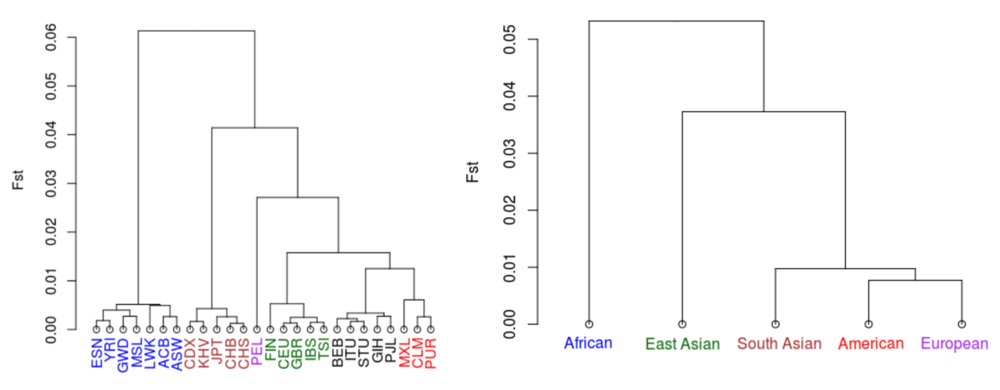

# Genetic Variation in miRNA Primary Transcripts

Undergraduate thesis (University of Toronto, Cell & Systems Biology and Computer Science, 2017): a population-genetics analysis in R of 1,127 SNPs across 1,881 human miRNA primary transcripts, using 2,503 genomes from 26 populations in Phase 3 of the [1000 Genomes Project](https://www.internationalgenome.org/).

 

Full write-up: [research report](Research%20Report.pdf) · [presentation](Presentation.pdf)

## Objectives

1. Measure genetic differentiation between human populations within miRNA primary transcripts.
2. Find SNPs specific to certain populations, which may have emerged through positive selection.

## Findings

- African populations showed the highest F<sub>ST</sub> values, the highest degree of genetic differentiation. A dendrogram built from pairwise F<sub>ST</sub> confirms that African populations diverged first.
- Variance and F<sub>ST</sub> were compared as measures of differentiation, and "average of ratios" and "ratio of averages" were compared for combining per-SNP F<sub>ST</sub> into one genome-wide value.
- 33 SNPs were identified as characteristic of particular populations and are candidates for positive selection.



## Pipeline

1. Subset the 1000 Genomes VCFs per population with `bcftools`, using the sample lists in `VCF/<population>/samples.txt`.
2. Find variants inside miRNA primary-transcript coordinates from miRBase Release 21 (`miRNA.gff3`) and write each population's variants and allele frequencies to a `results.tsv`.
3. Merge the per-population tables and compute variance and F<sub>ST</sub> per SNP and per population pair, then combine them genome-wide.
4. Plot heatmaps, cluster populations into dendrograms, and flag population-specific SNPs.

## Repository layout

```
R/
  main.R            entry point: runs the whole analysis
  getVariations.R   reads VCFs and writes SNPs inside miRNA transcripts to results.tsv
  mergeData.R       merges per-population results.tsv files
  analyzeData.R     variance, FST, and population-specific SNP detection
  getDendrogram.R   hierarchical clustering of populations
  imagePlot.R       heatmap plotting
VCF/<POP>/samples.txt   sample IDs for each of the 26 populations
miRNA.gff3.zip          miRNA genome coordinates
plots/plots.zip         all generated figures
images/                 figures used in this README
```

## Running it

1. Create an R project from this repository.
2. Download the Phase 3 VCFs from `ftp://ftp.1000genomes.ebi.ac.uk/vol1/ftp/release/20130502/` into `VCF/ALL/`.
3. From `VCF/`, subset each population (replace `POP` with a code such as `ACB`):
   ```bash
   for file in ALL/*.vcf.gz; do
     bcftools view --min-ac=1 --force-samples -Oz -S POP/samples.txt "$file" > POP/$(basename "$file")
   done
   ```
   Each population folder then holds `chr1.vcf.gz` to `chr22.vcf.gz`.
4. Unzip `miRNA.gff3.zip` into the project root.
5. Run `R/main.R`.

## Tech stack

R, bcftools, 1000 Genomes Phase 3, miRBase.

## Author

[Moeen Bagheri](https://moeenbagheri.com)
